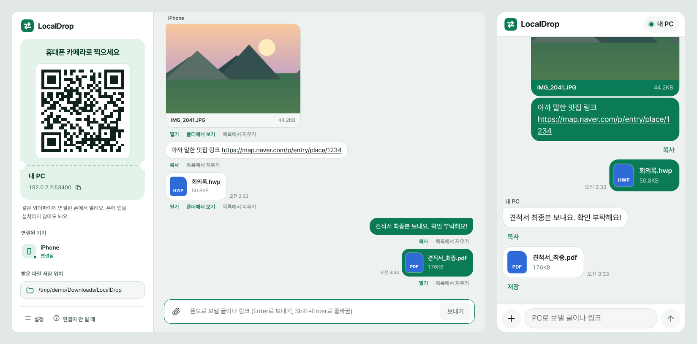

# LocalDrop

로컬에서 파일을 보낼 수 있는 프로그램 — 같은 와이파이에서 **폰 ↔ PC**로 사진·파일·글을 주고받아요.

PC에서 LocalDrop을 켜고 화면의 QR 코드를 폰 카메라로 찍으면 폰 브라우저에서 바로 열려요.
**폰에는 앱을 설치하지 않아도 되고, 계정도 필요 없어요.** 모든 전송은 집 와이파이 안에서 PC와 폰 사이에서만 오가고, 인터넷이나 다른 서버를 거치지 않아요.
카톡 '나에게 보내기' 대신 쓰기 좋게, 주고받은 것이 채팅처럼 쌓여요.



## 할 수 있는 것

- **폰 → PC**: 사진·동영상·파일을 보내면 PC의 `다운로드\LocalDrop` 폴더에 바로 저장돼요. 글이나 링크는 PC 클립보드에 자동으로 복사돼요.
- **PC → 폰**: 파일을 창에 끌어다 놓거나, 캡처한 화면을 `Ctrl+V` 하면 폰 화면에 바로 나타나요. 탐색기 오른쪽 클릭 '보내기' 메뉴로도 보낼 수 있어요.
- 큰 동영상도 끊김 없이 보내요 (진행률·속도 표시, 취소, 이어받기).
- QR 코드에 비밀 연결 코드가 들어 있어서 QR을 찍은 기기만 접속할 수 있어요.
- Windows를 켤 때 자동으로 실행해 두면 언제든 폰에서 바로 보낼 수 있어요.

## 설치

[Releases](https://github.com/game-addicted-man/LocalSend/releases)에서 받으세요.

| 파일 | 설명 |
|---|---|
| `LocalDrop-Setup.exe` | **설치 프로그램 (추천)** — 시작 메뉴·바탕화면 바로가기를 만들고, Windows 설정 → 앱에서 제거할 수 있어요. 관리자 권한은 필요 없어요. |
| `LocalDrop.exe` | 설치 없이 바로 실행하는 파일 하나짜리 버전 |

처음 실행할 때 두 가지 창이 뜰 수 있어요.

1. **Windows의 PC 보호** (파란 창): 서명이 없는 프로그램이라 뜨는 창이에요. [추가 정보] → [실행]을 누르세요.
2. **Windows 보안 경고 - 액세스 허용** (방화벽): **[허용]**을 눌러야 폰이 PC에 접속할 수 있어요.

필요한 환경: Windows 10 / 11 (64비트), 폰은 아이폰 Safari나 안드로이드 Chrome·삼성 인터넷 같은 요즘 브라우저.

## 사용법

1. PC에서 LocalDrop을 실행하고, 창 왼쪽의 QR 코드를 폰 카메라로 찍어요. (폰과 PC가 같은 와이파이여야 해요)
2. 폰 화면의 **[+]** → 사진·동영상 또는 다른 파일을 고르면 PC로 가요.
3. PC에서 보낼 때는 파일을 창에 끌어다 놓거나 클립 버튼을 누르세요. 폰에서 [저장]을 누르면 받아져요.
   아이폰에서 사진은 눌러서 크게 본 다음 길게 누르면 '사진 앱에 저장'할 수 있어요.

다음부터 빠르게 쓰려면:

- 폰: 브라우저 메뉴에서 **홈 화면에 추가**하면 아이콘으로 바로 열려요.
- PC: 설정에서 **Windows를 켤 때 자동으로 실행**을 켜 두세요.

### 폰에서 안 열릴 때

1. 폰 와이파이가 PC와 같은 공유기에 연결돼 있는지 확인해요. (LTE/5G로 바뀌어 있으면 안 돼요)
2. LocalDrop 창 → **연결이 안 될 때** → **방화벽 허용 다시 설정**을 누르고, 관리자 권한 창에서 '예'를 눌러요.
3. Windows 설정 → 네트워크 및 인터넷에서 지금 네트워크를 **개인 네트워크**로 바꿔요.
4. 게스트 와이파이나 'AP 격리(기기 간 통신 차단)'가 켜진 와이파이에서는 기기끼리 연결되지 않아요.
5. VPN을 쓰고 있다면 잠시 꺼 보세요.
6. PC에 네트워크가 여러 개면 QR 아래 **다른 주소로 바꾸기**에서 다른 주소를 골라 보세요.

### 제거

Windows 설정 → 앱 → 설치된 앱 → **LocalDrop** → 제거.
설정과 주고받은 기록은 함께 지워지고, 받은 파일(`다운로드\LocalDrop`)은 그대로 남아요.
설치 없이 쓴 경우에는 `LocalDrop.exe`와 `%APPDATA%\LocalDrop`, `%LOCALAPPDATA%\LocalDrop` 폴더를 지우면 돼요.

## 직접 빌드하기

필요한 것: [Go 1.24 이상](https://go.dev/dl/). 사용한 라이브러리는 모두 `vendor` 폴더에 들어 있어서 인터넷 없이도 빌드돼요.

- **Windows**: `build.bat` 더블클릭
- **맥·리눅스**: `sh build.sh`

`dist` 폴더에 `LocalDrop.exe`(앱)와 `LocalDrop-Setup.exe`(설치 프로그램)가 만들어져요.
아이콘·버전 정보는 `rsrc_windows_amd64.syso`(앱)와 `installer/rsrc_windows_amd64.syso`(설치 프로그램)에 들어 있고,
바꾸려면 [go-winres](https://github.com/tc-hib/go-winres)로 `winres/winres.json`을 고친 뒤 `go-winres make --arch amd64`를 다시 실행하세요.

```
go test -mod=vendor ./...                                        # 테스트
go run -mod=vendor . --headless --data ./devdata --save ./devrecv  # 창 없이 서버만 띄워 브라우저로 보기
```

실행 옵션: `--headless`(창 없이 서버만), `--browser`(앱 창 대신 기본 브라우저), `--port 53390`, `--data 폴더`(설정·기록 위치), `--save 폴더`(받은 파일 위치), `--minimized`(최소화로 시작), `--uninstall [--quiet]`(제거). 파일 경로를 넘기면 그 파일들을 바로 폰에 공유해요(탐색기 '보내기' 메뉴가 이렇게 실행해요).
설치 프로그램은 `LocalDrop-Setup.exe /S`로 묻지 않고 설치할 수 있어요.

### 릴리스 만들기

`v`로 시작하는 태그를 올리면 GitHub Actions가 테스트 후 두 파일을 만들어 Releases에 자동으로 첨부해요.

```
git tag v1.1.0
git push origin v1.1.0
```

버전을 올릴 때는 `internal/version/version.go`와 두 `winres.json`의 버전을 함께 바꾸고 `.syso`를 다시 만드세요.

## 구조

```
 ┌──────────── PC (LocalDrop.exe) ────────────┐           ┌──────── 폰 (브라우저) ────────┐
 │  앱 창 (WebView2)  ──  http://127.0.0.1/pc │           │  http://192.168.x.x:53390/?t=… │
 │         │                                  │  같은      │   · 사진·파일 고르기 → 업로드   │
 │   Go HTTP 서버 (포트 53390) ◄──────────────┼── 와이파이 ─┤   · 글 보내기                   │
 │    · 받은 파일 → 다운로드\LocalDrop         │           │   · PC가 보낸 파일 저장         │
 │    · 실시간 알림 (Server-Sent Events)       │           └────────────────────────────────┘
 └────────────────────────────────────────────┘
```

| 위치 | 하는 일 |
|---|---|
| `main.go` | 시작·종료, 포트 열기, 로그, 한 번만 실행되게 하기 |
| `app.go` | 설정(`config.json`), 주고받은 기록(`history.json`), 연결된 기기 |
| `server.go` | HTTP 경로, 인증(폰은 QR의 비밀 코드, PC 화면은 이 PC 안 + 관리 토큰), 업로드·다운로드 |
| `hub.go` | 열려 있는 화면들에 실시간 알림 보내기 |
| `files.go` | Windows에서 안전한 파일 이름, 같은 이름이면 `(1)` 붙이기, 한글 파일 이름 다운로드, 폴더를 zip으로 보내기 |
| `netinfo.go` | 폰이 접속할 PC 주소 고르기 (가상 어댑터·VPN 주소는 뒤로) |
| `qr.go`, `notify.go`, `instance.go` | QR 코드(SVG), 받으면 알림, 두 번째 실행 시 켜져 있는 창으로 넘기기 |
| `ui_windows.go`, `uninstall_windows.go` | 앱 창, 파일·폴더 선택, 방화벽 설정, 바로가기, 제거 |
| `installer/` | 설치 프로그램 (`LocalDrop-Setup.exe`) |
| `internal/winutil/` | 앱과 설치 프로그램이 함께 쓰는 Windows 기능 (바로가기, '설치된 앱' 등록, 실행 중인 앱 끄기) |
| `web/` | 화면 (PC 화면 `pc.html`, 폰 화면 `phone.html`, 스크립트·스타일, Pretendard 글꼴) |
| `third_party/go-webview2/` | 앱 창 라이브러리 (초기화 실패 시 프로그램을 끄지 않도록 고친 사본) |

## 보안

- **폰 접속**: QR 코드에 96비트 무작위 코드가 들어 있어요. 코드가 없거나 틀리면 아무것도 볼 수 없어요. 설정의 **새 QR 만들기**로 언제든 바꿀 수 있고, 바꾸면 예전 코드로 연결된 폰은 바로 끊겨요.
- **PC 화면(관리 기능)**: 이 PC 안(127.0.0.1)에서, 실행할 때마다 새로 만드는 관리 토큰이 있어야 해요. 다른 웹사이트가 몰래 요청을 보내거나(CSRF) 주소를 속이는 공격(DNS 리바인딩)도 막아요.
- 폰이 보낸 파일 이름은 정리해서 저장해요 (`..\` 같은 경로, Windows 예약 이름, 금지 문자 제거). 받는 도중 끊기면 임시 파일을 지워요.
- 통신은 http(암호화 없음)예요. 카페 같은 공용 와이파이보다는 집·사무실처럼 믿을 수 있는 네트워크에서 쓰세요.

## 사용한 라이브러리

- [jchv/go-webview2](https://github.com/jchv/go-webview2) (MIT) — 앱 창. 고친 부분은 `third_party/go-webview2/LOCALDROP_PATCH.md` 참고
- [ncruces/zenity](https://github.com/ncruces/zenity) (MIT) — 파일·폴더 선택 창, 알림, 설치 프로그램 대화상자
- [skip2/go-qrcode](https://github.com/skip2/go-qrcode) (MIT) — QR 코드
- [atotto/clipboard](https://github.com/atotto/clipboard) (BSD-3-Clause) — 클립보드
- [Pretendard](https://github.com/orioncactus/pretendard) 글꼴 (SIL Open Font License, `web/static/fonts/Pretendard-LICENSE.txt`)
